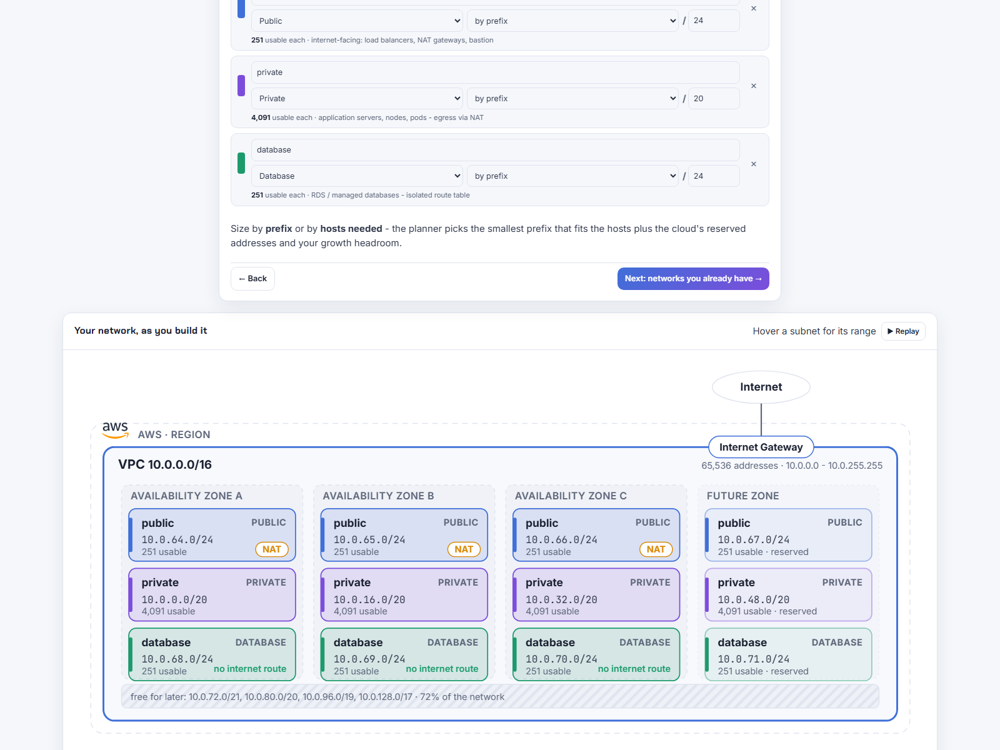
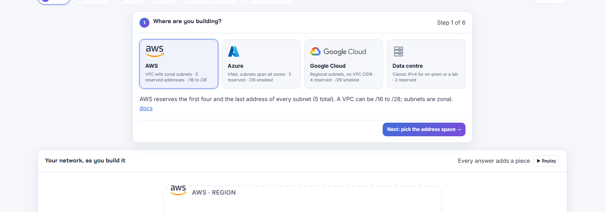
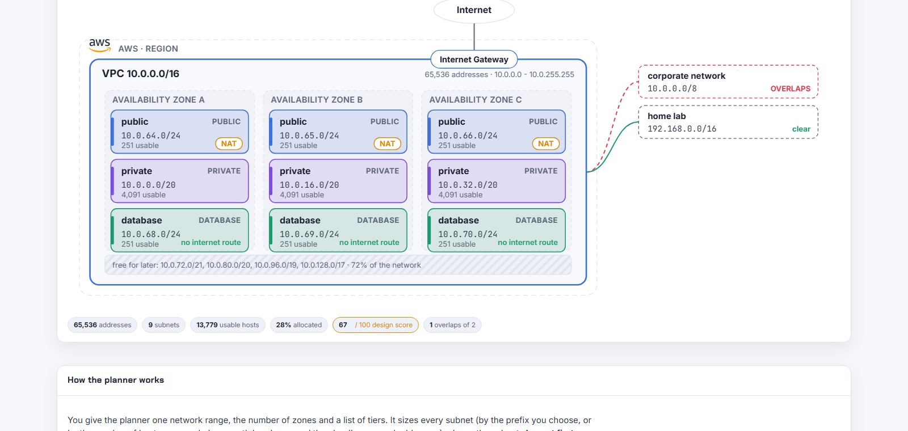
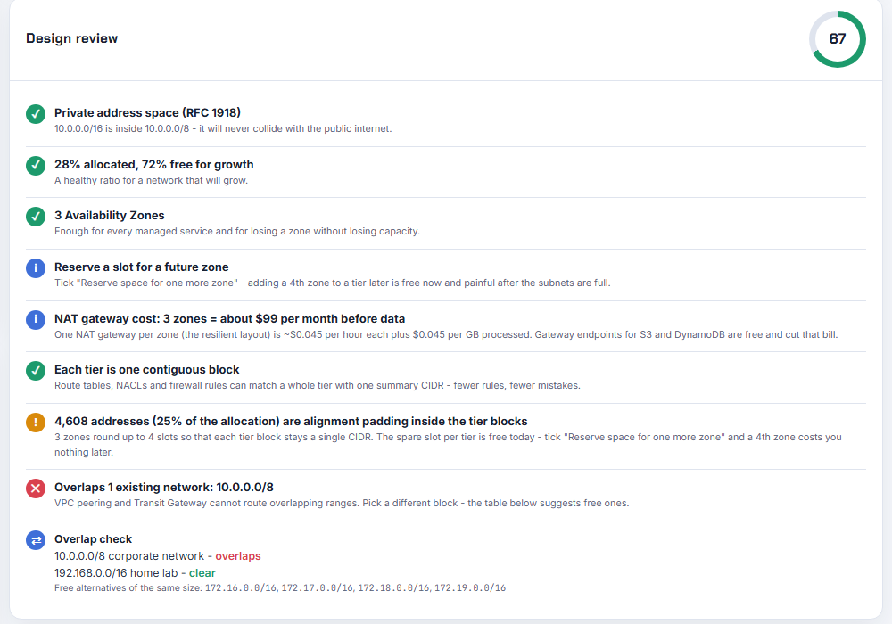
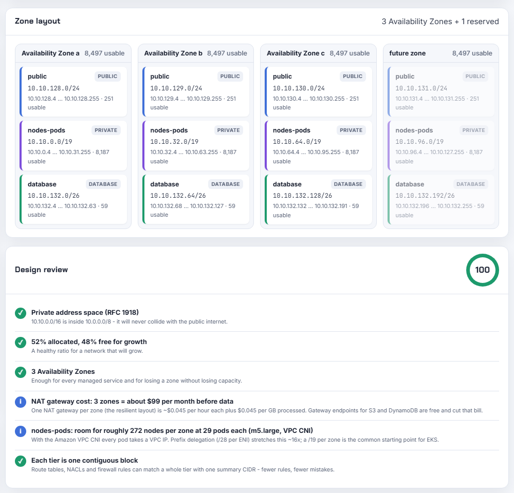
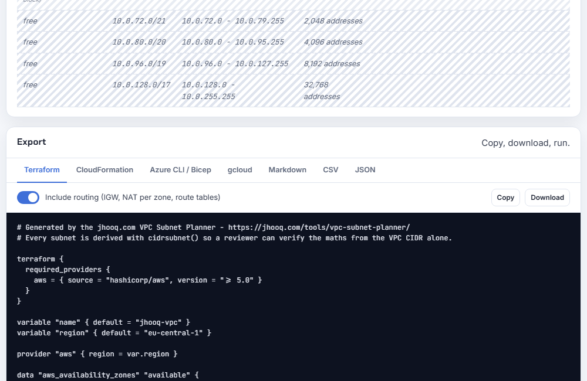

# VPC Subnet Planner

[](https://github.com/rahulwagh/vpc-subnet-planner/actions/workflows/ci.yml)
[](LICENSE)
[](https://jhooq.com/tools/vpc-subnet-planner/)

**Design a multi-zone VPC, VNet or Google Cloud address plan the way it should be designed** - see the whole address space as a map, let the planner pack and align every subnet, check the design against the networks you already have, and leave with Terraform, CloudFormation, Azure CLI or gcloud you can run.

- **Use it:** https://jhooq.com/tools/vpc-subnet-planner/ (free, no sign-up, nothing leaves your browser)
- **Read the story behind it:** https://jhooq.com/vpc-subnet-planner-free-tool-aws-azure-gcp/
- **One file, no build:** [`index.html`](index.html) is the entire tool. Clone and open it, or `node scripts/serve.js`.



## How it feels

The planner asks one question at a time and draws the network underneath as you answer, so a first-time visitor is never looking at every control at once:

1. **Where are you building?** AWS, Azure, Google Cloud or a data centre (official logos, one line on what each one means for subnets).
2. **Which address space?** Type a CIDR or pick a common one. The VPC box draws itself with its range.
3. **How many zones?** Each zone becomes a column. Skipped on Azure and Google Cloud, where subnets are not zonal.
4. **What goes inside?** Pick a layout, edit the tiers. Subnets drop into each zone column one by one, named first, CIDR and usable count a moment later, with NAT and "no internet route" badges.
5. **What must it not collide with?** Paste existing networks; each one appears beside the VPC with a clear or overlaps line.
6. **Your design.** Summary with edit links, share link, replay, and the full results below.





**Expert view** (top right) puts every control and every result on one screen, which is the layout experienced users asked for. The choice is remembered, and the share link carries the view and the step, so a shared plan opens at the review step and replays the build for the recipient.

## Why another CIDR calculator

Most subnet calculators split a range into equal parts and tell you the first and last address. That is not how a cloud network is designed. A real design has a `/19` for Kubernetes nodes next to a `/24` for load balancers and a `/26` for databases, repeated per zone, aligned so that each tier can be summarised by one route, with room left for the zone you will add next year, and it must not overlap the VPCs and offices you will peer with. The planner does that part:

| What you get | Why it matters |
|---|---|
| **Cloud reserved addresses applied** (AWS 5, Azure 5, Google Cloud 4 per subnet) | a `/24` has 251 usable hosts on AWS, not 254; `/28` is the smallest AWS subnet, `/29` on Azure and GCP |
| **Largest-first aligned packing** | mixed subnet sizes never overlap and leftover space stays in clean CIDR blocks |
| **Contiguous tier blocks** | all private subnets live inside one summary CIDR: one route, one NACL rule, one firewall rule per tier |
| **Future-zone reservation** | reserve a 4th-zone slot today for free instead of renumbering later |
| **Size by hosts with growth headroom** | "800 app servers + 50 %" becomes the right prefix, reserved addresses included |
| **Overlap check with suggestions** | paste every VPC, VNet, office and partner range; the review fails on overlap and proposes free blocks of the same size |
| **Design review with a score** | RFC 1918, VPC size limits, ALB minimums, zone count, headroom, NAT gateway cost, EKS node capacity, alignment padding |
| **Exports that validate** | Terraform with `cidrsubnet()` per subnet and per-zone NAT routing, CloudFormation, Azure CLI / Bicep, gcloud, Markdown, CSV, JSON |
| **Share link** | the whole plan is encoded in the URL fragment - no server, no account, no storage |
| **Teach-me mode** | every card explains the concept and links the companion video and tutorial |

## Try it in 60 seconds

1. Open https://jhooq.com/tools/vpc-subnet-planner/
2. Pick a cloud, type the network (`10.0.0.0` / `16`) and the number of zones.
3. Choose a preset or add tiers. Size each tier by prefix or by hosts.
4. Paste the ranges you already use under "Existing networks".
5. Read the design review, hover the map, then copy or download the export.
6. Click **Copy link** to share the exact plan with a colleague.

Example plans you can open straight away (each example folder below carries its link):

| Scenario | Open |
|---|---|
| AWS three-tier, 3 AZs + reserved 4th, 10.0.0.0/16 | [examples/aws-three-tier](examples/aws-three-tier/README.md) |
| AWS EKS cluster, /19 node-and-pod subnets | [examples/aws-eks-cluster](examples/aws-eks-cluster/README.md) |
| AWS inspection hub with firewall and Transit Gateway subnets | [examples/aws-hub-firewall-tgw](examples/aws-hub-firewall-tgw/README.md) |
| AWS sized by hosts (50 / 800 / 20 per zone, 50 % growth) | [examples/aws-by-hosts](examples/aws-by-hosts/README.md) |
| Azure three-tier VNet | [examples/azure-three-tier](examples/azure-three-tier/README.md) |
| Google Cloud three-tier | [examples/gcp-three-tier](examples/gcp-three-tier/README.md) |

## How the planner works

1. **Normalise** the network: the typed address is snapped to the boundary of its prefix (and the review says so).
2. **Size** every tier: prefix as typed, or `ceil(hosts × (1 + growth)) + reserved` rounded up to a power of two.
3. **Build blocks**: in contiguous mode each tier becomes one block of `subnet size × zones rounded up to a power of two`. Three zones round up to four slots; the fourth slot is *alignment padding* and is exactly the space a future zone needs.
4. **Pack** the blocks largest-first at the first aligned free address.
5. **Report** the leftover as the fewest aligned CIDR blocks, so a new tier can take one without renumbering.
6. **Review** the design (table below) and **check overlap** against the networks you listed.

Full walkthrough with the reasoning behind each step: [docs/algorithm.md](docs/algorithm.md).



## Reserved addresses per subnet

| Cloud | Reserved | Which addresses | Smallest subnet | Usable in a /24 |
|---|---|---|---|---|
| AWS | 5 | network, VPC router (.1), Amazon DNS (.2), future use (.3), broadcast (last) | /28 (11 usable) | 251 |
| Azure | 5 | network, default gateway (.1), Azure DNS (.2 and .3), broadcast (last) | /29 (3 usable) | 251 |
| Google Cloud | 4 | network, default gateway (.1), second-to-last (future use), broadcast (last) | /29 (4 usable) | 252 |
| Generic IPv4 | 2 | network, broadcast | /30 (2 usable) | 254 |

Sources and the per-consumer address budget (ALB, NAT, endpoints, EKS pods, RDS): [docs/reserved-addresses.md](docs/reserved-addresses.md). Usable hosts for every prefix from /16 to /30: [docs/cidr-cheatsheet.md](docs/cidr-cheatsheet.md).

## The design rules it checks

| Rule | Result | Why |
|---|---|---|
| Network inside 10/8, 172.16/12 or 192.168/16 | fail if public, warn for 100.64/10 | public ranges work inside a VPC but make real internet hosts unreachable and fail compliance reviews |
| AWS VPC prefix between /16 and /28 | fail | the API rejects anything else; add secondary CIDRs instead |
| Tier not smaller than the cloud minimum | fail | /28 AWS, /29 Azure and GCP |
| Tier at or near the minimum (not transit) | warn | every load balancer node, Lambda ENI, endpoint and pod takes an address |
| Public tier smaller than /27 | fail | an Application Load Balancer needs 8 free addresses per subnet in 2 zones |
| Fewer than 2 zones | warn | ALB and RDS Multi-AZ need two; three is the production norm |
| No future-zone slot reserved (under 4 zones) | info | reserving is free now and painful later |
| Alignment padding present | warn (info when a future zone is reserved) | three zones round up to four slots; the spare slot per tier is free today |
| 95 % or more allocated | warn | the next tier or node group means a second CIDR block or a rebuild |
| Overlap with an existing network | fail | peering and Transit Gateway refuse overlapping ranges; free alternatives are listed |
| NAT gateway cost | info | zones × $0.045 per hour, about $99 per month for three, before data; S3 and DynamoDB gateway endpoints are free |
| Tier named node / pod / eks / k8s | info | nodes per zone at 29 pods each (m5.large, VPC CNI); overlay CNIs on AKS and GKE only consume node addresses |
| Each tier contiguous | ok | one summary CIDR per tier |

Score = 100 − 25 per fail − 8 per warning.

## Presets

| Preset | Tiers | Typical use |
|---|---|---|
| Three tier (web, app, data) | public /24, private /20, database /24 | the default production layout |
| EKS cluster | public /24, nodes-pods /19, database /26 | Amazon VPC CNI: every pod takes a VPC address; /19 per zone leaves 8,187 usable (about 270 m5.large nodes at 29 pods) |
| Minimal lab | public /24, private /24 | learning, demos, one-off tests |
| Hub (firewall + TGW) | firewall /26, public /26, tgw-attach /28 | inspection VPC in a hub-and-spoke design |
| By hosts | web 50, app 800, db 20 hosts | let the planner pick the prefix, with growth headroom |



## Exports

The Terraform export is the one most people take home. Every subnet is derived with `cidrsubnet()` so a reviewer can verify the maths from the VPC CIDR alone, and with routing on it builds an Internet Gateway, one NAT gateway per zone with per-zone private route tables, an isolated route table for database and transit tiers, and a free S3 gateway endpoint:

```hcl
locals {
  vpc_cidr = "10.0.0.0/16"
  azs      = slice(data.aws_availability_zones.available.names, 0, 3)

  # name => { cidr, az index, tier, public }
  subnets = {
    "private-a"  = { cidr = cidrsubnet(local.vpc_cidr, 4, 0), az = 0, tier = "private", role = "private", public = false } # 10.0.0.0/20
    "private-b"  = { cidr = cidrsubnet(local.vpc_cidr, 4, 1), az = 1, tier = "private", role = "private", public = false } # 10.0.16.0/20
    "private-c"  = { cidr = cidrsubnet(local.vpc_cidr, 4, 2), az = 2, tier = "private", role = "private", public = false } # 10.0.32.0/20
    "public-a"   = { cidr = cidrsubnet(local.vpc_cidr, 8, 64), az = 0, tier = "public", role = "public", public = true }   # 10.0.64.0/24
    ...
  }
}
```

All formats, what each contains and the reasoning behind the routing choices: [docs/exports.md](docs/exports.md).



## Verification

The engine is covered by behavioural tests and every AWS example is validated against a real Terraform. Output from the release run on 2026-10-12 (Node 22.23.2, Terraform 1.16.2, AWS provider 6.x):

```console
$ node --test test/engine.test.js
ok 1 - ip helpers round-trip and reject bad input
ok 2 - hostsToPrefix adds growth headroom and the reserved addresses
ok 3 - every preset packs without overlap, on aligned boundaries, inside the network
ok 4 - three zones in contiguous mode leave one padding slot per tier, and a reserved 4th zone uses it
ok 5 - non-contiguous mode packs every subnet largest-first with no padding at all
ok 6 - contiguous mode keeps each tier inside one summary block
ok 7 - reserving a future zone adds a 4th slot but no 4th live subnet
ok 8 - reserved addresses follow each cloud
ok 9 - a mistyped network address is snapped to its boundary and flagged
ok 10 - public ranges and illegal AWS sizes fail the review
ok 11 - overlap with an existing network is detected and free alternatives are suggested
ok 12 - a plan that cannot fit reports which tier failed instead of silently truncating
ok 13 - free space is reported as aligned CIDR blocks
ok 14 - Terraform export derives every subnet with cidrsubnet() that reproduces the planned CIDR
ok 15 - the other exporters cover every subnet
# pass 15
# fail 0

$ cd examples/aws-three-tier && terraform init -backend=false && terraform validate && terraform fmt -check
Success! The configuration is valid.
```

The same checks run in GitHub Actions on every push ([ci.yml](.github/workflows/ci.yml)): engine tests, "examples are up to date", `terraform validate` + `fmt -check` for the four AWS scenarios, `bash -n` for the Azure and gcloud scripts, `JSON.parse` for the JSON exports.

## Privacy

No server, no account, no analytics inside the tool. The plan lives in the URL fragment (`#...`), which browsers never send to the server. Format of the share link: [docs/share-link.md](docs/share-link.md).

## Learn the concepts

The planner's Teach-me mode links these, and they are the best place to start if the map does not make sense yet:

| Topic | Video | Tutorial |
|---|---|---|
| CIDR notation and how to size ranges | [What is CIDR?](https://youtu.be/KiWXRL-2TnY) | [jhooq.com/what-is-cidr-classless-inter-domain-routing](https://jhooq.com/what-is-cidr-classless-inter-domain-routing/) |
| VPC, subnets, NAT, Internet Gateway, route tables on AWS | [AWS VPC step by step](https://youtu.be/43tIX7901Gs) | [jhooq.com/aws-vpc-public-private-subnet-nat-internet-gateway-route-table](https://jhooq.com/aws-vpc-public-private-subnet-nat-internet-gateway-route-table/) |
| VNet, subnets, NSG, route tables on Azure | [Azure VNet step by step](https://youtu.be/KjkIVgW4Dms) | [jhooq.com/azure-vnet-subnet-nsg-route-table-step-by-step](https://jhooq.com/azure-vnet-subnet-nsg-route-table-step-by-step/) |
| Why overlapping ranges cannot peer | - | [AWS VPC peering](https://jhooq.com/aws-vpc-peering-step-by-step/), [Azure VNet peering](https://jhooq.com/azure-vnet-peering-step-by-step/), [Transit Gateway](https://jhooq.com/aws-transit-gateway-step-by-step/) |

## Development

```bash
git clone https://github.com/rahulwagh/vpc-subnet-planner.git
cd vpc-subnet-planner
node scripts/serve.js                # http://localhost:8080/
node --test test/engine.test.js      # engine tests (or: npm test)
node scripts/generate-examples.js    # regenerate examples/ after an engine change
```

The engine (pure functions: `plan`, `review`, `suggestFree`, the exporters) sits in the last `<script>` of `index.html` before the rendering code; [`test/extract-engine.js`](test/extract-engine.js) loads exactly that part into a Node `vm` context, which is how the tests and the example generator run it without a browser.

Repository layout:

```
index.html                  the tool (also deployed to jhooq.com/tools/vpc-subnet-planner/)
og.png, og.svg              social preview image
docs/                       algorithm, reserved addresses, CIDR cheat sheet, exports, share-link format
docs/img/                   screenshots used in this README
examples/<scenario>/        generated exports + README with the share link for that plan
scripts/generate-examples.js, scripts/serve.js
test/engine.test.js, test/extract-engine.js
.github/workflows/ci.yml
```

## Roadmap

Ideas collected from the first readers - open an issue if you want one of them sooner:

- Kubernetes pod and service range planner (VPC CNI prefix delegation, GKE secondary ranges, AKS overlay).
- Multi-VPC and multi-account planner: allocate /16s from a /8 per environment and region, with an IPAM-style inventory.
- IPv6 dual-stack: /56 per VPC, /64 per subnet, with the cloud rules for IPv6-only subnets.
- Import an existing network from `aws ec2 describe-subnets` / `az network vnet show` output.

## Contributing and licence

See [CONTRIBUTING.md](CONTRIBUTING.md). MIT licence - use it, fork it, embed it; a link back to https://jhooq.com/tools/vpc-subnet-planner/ is appreciated.

The AWS, Microsoft Azure and Google Cloud marks are trademarks of their owners and are used here only to identify the provider you are designing for; they are not covered by the MIT licence.

Built by [Rahul Wagh](https://jhooq.com/about/) - [YouTube](https://www.youtube.com/@RahulWagh) - [jhooq.com](https://jhooq.com).
